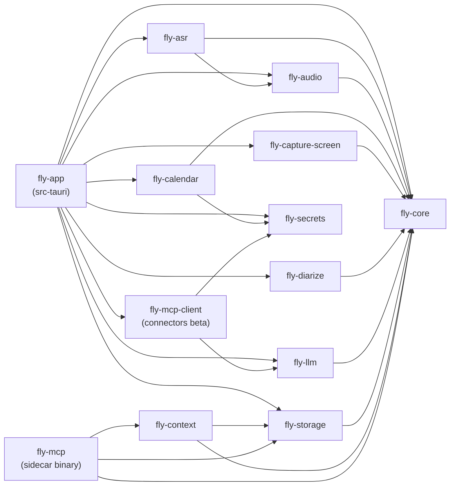

# Component catalog

Fly on the Wall is a modular monolith: one desktop process (Tauri 2) plus one sidecar binary (the MCP server). This catalog makes the modules explicit. It gives each one a doc covering what it owns, everything it touches, the rules it must keep, and the tests that cover it. You can then change, test or extract one component without reading the whole codebase.

Written against main `82b7edf` (v2.4.0, 2026-10-28), then refreshed after #86 merged (`f2b8981`) and for backend-only cloud consent (#102). [In-flight work](#in-flight-work) lists what's about to change.

"Spec" throughout means the [UX rollout and platform design](../superpowers/specs/2026-10-27-ux-rollout-and-platform-design.md). Its §2 lists the invariants every PR must keep.

- **Start here:** find your component in the [index](#index). Its doc's **Surface area** section lists every command, event, settings key, table, file, host, process and secret it touches.
- **Changing something?** Read the component's **Invariants** and **Changing it safely** first. Then check the [boundary rules](#boundary-assessment).
- **Adding a Tauri command?** Add a row to exactly one `app-*.md` doc (see [Command ownership](#command-ownership)), mirror it in `frontend/src/devMock.ts` (spec §2), and register it in `src-tauri/src/lib.rs`.

## The golden rule

From [`ARCHITECTURE.md`](../../ARCHITECTURE.md): **the UI talks to `fly-core` types via Tauri commands only. `fly-core` depends on trait crates, never on OS-specific impls. Impl selection happens once, in `src-tauri`.**

Three layers:

| Layer | Where | Components |
|---|---|---|
| **Frontend features** | `frontend/src` (React in the webview; semi-trusted) | 11 `ui-*` docs |
| **Backend features** | `src-tauri/src` (the `fly-app` crate: composition root, app state, all 129 Tauri commands) | 16 `app-*` docs |
| **Crates** | `crates/fly-*` (domain, trait and impl crates; no Tauri) | 12 `fly-*` docs |

## Index

### Crates

| Component | Purpose |
|---|---|
| [fly-core](fly-core.md) | Domain model and pure logic: notes, blocks with provenance, transcript model, word↔speaker aligner, cross-talk dedup, repetition guard, Enhance prompt and parse. No OS, no network. |
| [fly-audio](fly-audio.md) | `AudioCapture` trait plus per-OS backends: WASAPI (Windows), CoreAudio process tap (macOS), PulseAudio loopback (Linux). Also mixing, VAD and mute detection. |
| [fly-asr](fly-asr.md) | `TranscriptionEngine`: the whisper.cpp sidecar (CPU/Vulkan), Groq cloud ASR, retries and checkpoints. |
| [fly-diarize](fly-diarize.md) | Local speaker diarization: sherpa-onnx embeddings, fbank, VBx clustering, refinement. Always local. |
| [fly-llm](fly-llm.md) | `LLMProvider` trait plus Anthropic and OpenAI-compatible (Ollama, custom) providers, streaming, JSON repair, the dormant tool loop, the mock, and golden request bodies. |
| [fly-context](fly-context.md) | The read-only retrieval, tool and memory layer for AI readers, with a fail-closed keep-local filter. It backs the MCP server's context layer and passage search, and agentic Ask (the harness is next). |
| [fly-calendar](fly-calendar.md) | `CalendarProvider`: Google and Microsoft Graph over OAuth, plus meeting-link parsing. |
| [fly-capture-screen](fly-capture-screen.md) | `ScreenRecorder`: Windows Graphics Capture, ffmpeg, window listing. |
| [fly-storage](fly-storage.md) | SQLite index (FTS5, vectors, migrations) plus the user-owned files on disk: atomic mirrors, manifests, self-heal, path containment, scratch, erase. |
| [fly-secrets](fly-secrets.md) | `SecretStore` over the OS keychain. Every API key and OAuth token lives here. |
| [fly-mcp](fly-mcp.md) | The `flyonthewall-mcp` stdio MCP server: read-only tools over fly-storage, plus one label write. |
| [fly-mcp-client](fly-mcp-client.md) | Connectors (beta): FOTW's Ask agent calling tools on MCP servers the user connects, on `rmcp` 3.8.0, with the spec §4.3 safety rules (approval bound to a config hash, pinned tool definitions, per-tool permissions, fenced results, https-only network guard, OAuth, keychain secrets). |

### Backend features (`src-tauri/src`)

| Component | Files | Purpose |
|---|---|---|
| [app-shell](app-shell.md) | `lib.rs`, `startup.rs`, `state.rs`, `logging.rs`, `nav_guard.rs`, `main.rs`, `tauri.conf.json`, `capabilities/` | Composition root: plugins, startup tasks, `AppState`, data-dir resolution, logging, CSP, nav guard, asset scope. |
| [app-notes-library](app-notes-library.md) | `commands.rs` (part) | Folders, notes, attachments, export, open and reveal. |
| [app-search](app-search.md) | `commands.rs` (part), `embeddings.rs` | Keyword and semantic search, plus the background embedding indexer. |
| [app-settings-consent](app-settings-consent.md) | `commands.rs` (part), `llm_commands.rs` (part) | Generic settings and the webview allowlists, LLM settings, cloud consent (the native dialog and the only consent writer), consent-skipped re-runs. **Has the app-wide settings-key registry.** |
| [app-recording](app-recording.md) | `recording.rs`, `live.rs` | Recording lifecycle, capture, live captions, meeting lookups. |
| [app-pipeline](app-pipeline.md) | `pipeline.rs`, `scheduler.rs`, `asr_commands.rs` | Transcribe → diarize → align → store, re-diarize, the job queue, the background AI pass, transcript edits. |
| [app-import](app-import.md) | `import_commands.rs` | Staged multi-file media import. |
| [app-llm](app-llm.md) | `llm_commands.rs`, `extraction.rs` | `build_provider` (the only LLM constructor: consent and keep-local), Enhance, Ask, polish, extraction, templates. |
| [app-calendar](app-calendar.md) | `calendar_commands.rs`, `calendar_defaults.rs` | Calendar connect/disconnect, upcoming meetings, starting a meeting from an event. |
| [app-privacy](app-privacy.md) | `privacy.rs` | Keep local, participant notice, audio retention, "Delete all my data", disk-encryption check. |
| [app-models-gpu](app-models-gpu.md) | `models.rs`, `model_cleanup.rs`, `gpu.rs`, `hw.rs`, `download_model` | Pinned model and tool downloads, model cleanup ("Free up space"), GPU verdict, hardware detection. |
| [app-ollama](app-ollama.md) | `ollama.rs` | Managed `ollama serve` child, model pull and delete, status. |
| [app-mcp-sidecar](app-mcp-sidecar.md) | `commands.rs` (`mcp_config`), `scripts/prepare-sidecars.mjs`, `externalBin` | Shipping and wiring the MCP binary. |
| [app-screen-recording](app-screen-recording.md) | `screen_commands.rs` | Screen recording and video thumbnails. |
| [app-updater](app-updater.md) | updater + process plugins, `frontend/src/updater.ts` | Signed auto-update, deferred while recording. |
| [app-connectors](app-connectors.md) | `connectors.rs` | Connectors (beta): backend-only registry, native dialogs for every trust grant, the confirm-card approver, Claude Desktop import, `turn_for_ask` for the Ask harness. |

### Frontend features (`frontend/src`)

| Component | Main files | Purpose |
|---|---|---|
| [ui-app-shell](ui-app-shell.md) | `main.tsx`, `LibraryGate.tsx`, `App.tsx`, `api.ts`, `devMock.ts`, `ui.tsx`, `types.ts` | Orchestration, the IPC wrapper, the fake backend, design primitives. |
| [ui-home](ui-home.md) | `Home.tsx`, `NoteList.tsx`, `Sidebar.tsx`, `homeModel.ts`, `noteDeletion.ts` | Home, the notes list, folders, status chips, undoable delete. |
| [ui-editor](ui-editor.md) | `Editor.tsx`, `NotesEditor.tsx`, `EnhancedDoc.tsx`, `TranscriptPanel.tsx`, `safeContent.ts` | A note: your notes, the Enhanced doc with sources, and the transcript. |
| [ui-ask](ui-ask.md) | `AskPanel.tsx`, `askModel.ts` | The Ask sheet. |
| [ui-settings](ui-settings.md) | `SettingsModal.tsx`, `settingsModel.ts`, `PrivacySection.tsx` | Full-window Settings. |
| [ui-import](ui-import.md) | `ImportQueue.tsx`, `importProgress.ts` | The import panel. |
| [ui-notices](ui-notices.md) | `AppNotices.tsx`, `notices.ts`, `pipelineNotice.ts`, `pipelineFailures.ts` | The single notice stack and its notice kinds. |
| [ui-recording-bar](ui-recording-bar.md) | `RecordingBar.tsx`, `recordingBar.ts`, `LivePane.tsx` | Recording controls, capture warnings, live captions. |
| [ui-attendees](ui-attendees.md) | `AttendeeEditor.tsx`, `calendarMatch.ts` | Attendee roster, confirmation, re-diarize with undo. |
| [ui-confirm-consent](ui-confirm-consent.md) | `confirm.tsx`, `CloudConsent.tsx` | The in-app confirm dialog, and every cloud-consent request (the backend shows the dialog). |
| [ui-connectors](ui-connectors.md) | `ConnectorsSection.tsx`, `ConnectorDetail.tsx`, `ConnectorAdd.tsx`, `ConnectorCallCard.tsx`, `connectorsModel.ts` | Settings › Connectors (list, Browse, Add, detail with per-tool permissions) and the call cards; trust grants happen in the backend's native dialogs. |

## Dependency diagrams

### Crate graph (exact, from the `Cargo.toml` files)

- `fly-core` and `fly-secrets` depend on no other workspace crate.
- `fly-app` depends on neither `fly-mcp` (it ships as a separate binary, see [app-mcp-sidecar](app-mcp-sidecar.md)) nor `fly-context`. `fly-mcp` uses fly-context for its context layer and passage search, and the Ask harness wires it into the app.
- Network-capable crates (`reqwest`): `fly-asr`, `fly-llm`, `fly-calendar`, `fly-mcp-client` (connectors, behind its network guard), and `fly-app`. **`fly-mcp`, `fly-storage`, `fly-core` and `fly-context` have no HTTP client.** This is what keeps spec §2 "the MCP binary never holds keys or calls a cloud LLM" true today. The [boundary rules](#how-to-enforce-boundaries-cheaply) propose checking it mechanically.

### Component map (main edges)

```mermaid
flowchart TB
  subgraph FE["Frontend (webview)"]
    direction LR
    uiShell["ui-app-shell<br/>App.tsx · api.ts · devMock"]
    uiHome["ui-home"]
    uiEditor["ui-editor"]
    uiAsk["ui-ask"]
    uiSettings["ui-settings"]
    uiImport["ui-import"]
    uiNotices["ui-notices"]
    uiRec["ui-recording-bar"]
    uiAtt["ui-attendees"]
    uiConfirm["ui-confirm-consent"]
  end

  subgraph BE["Backend features (fly-app)"]
    direction LR
    shell["app-shell<br/>AppState · startup"]
    notes["app-notes-library"]
    search["app-search"]
    settings["app-settings-consent"]
    rec["app-recording"]
    pipe["app-pipeline"]
    imp["app-import"]
    llmApp["app-llm<br/>build_provider"]
    calApp["app-calendar"]
    priv["app-privacy"]
    models["app-models-gpu"]
    oll["app-ollama"]
    mcpCfg["app-mcp-sidecar"]
    screen["app-screen-recording"]
    upd["app-updater"]
  end

  subgraph CR["Crates"]
    direction LR
    core["fly-core"]
    sto["fly-storage"]
    sec["fly-secrets"]
    audio["fly-audio"]
    asr["fly-asr"]
    diar["fly-diarize"]
    llm["fly-llm"]
    cal["fly-calendar"]
    cap["fly-capture-screen"]
    ctx["fly-context"]
  end

  mcpBin["flyonthewall-mcp<br/>(fly-mcp, separate process)"]

  FE -- "invoke() via api.ts / events" --> BE
  uiConfirm -. "consent asked via request_cloud_consent, read via get_app_setting" .-> settings

  rec --> audio & pipe
  rec --> calApp
  pipe --> asr & diar & core & sto
  pipe --> llmApp
  imp --> pipe
  llmApp --> llm & sec & sto
  search --> oll
  oll --> models
  pipe --> models
  screen --> cap & models
  calApp --> cal & sec
  priv --> sto & sec
  notes --> sto
  settings --> sto
  shell --> sto & sec & audio

  mcpBin --> sto
  ctx -. "not wired yet" .-> sto
```

Back-edges inside `fly-app` that the map doesn't show, measured with `grep crate::<module>`:
- `scheduler` → `pipeline`, `import_commands`, `llm_commands`, `extraction`, `models`;
- `llm_commands` → `commands`, `ollama`, `scheduler`;
- `privacy` → `calendar_commands`, `scheduler`;
- `state` → `calendar_commands`, `live`, `llm_commands`, `recording`, `screen_commands`. The state module depends on feature modules, which inverts the layering.
- `embeddings` → `llm_commands` (`is_loopback_url`), `ollama`, `models`.

## Command ownership

Each of the 129 commands in `tauri::generate_handler!` (`src-tauri/src/lib.rs`) is documented in exactly one backend doc. It's the row whose first cell is the backticked command name.

| Doc | Commands |
|---|---|
| [app-shell](app-shell.md) | 6 |
| [app-notes-library](app-notes-library.md) | 20 |
| [app-search](app-search.md) | 2 |
| [app-settings-consent](app-settings-consent.md) | 7 |
| [app-recording](app-recording.md) | 12 |
| [app-pipeline](app-pipeline.md) | 14 |
| [app-import](app-import.md) | 3 |
| [app-llm](app-llm.md) | 12 |
| [app-ollama](app-ollama.md) | 3 |
| [app-models-gpu](app-models-gpu.md) | 3 |
| [app-calendar](app-calendar.md) | 8 |
| [app-screen-recording](app-screen-recording.md) | 5 |
| [app-privacy](app-privacy.md) | 12 |
| [app-mcp-sidecar](app-mcp-sidecar.md) | 1 |
| [app-updater](app-updater.md) | 0 (plugin-provided) |
| [app-connectors](app-connectors.md) | 20 |

## Network egress at a glance

Every host the app or its child processes contact. Detail and gates are in each owning doc.

| Host(s) | Carries meeting content? | When | Gate | Owner |
|---|---|---|---|---|
| `api.anthropic.com` (fixed); `api.openai.com` or a custom https URL; `integrate.api.nvidia.com` | Yes | Enhance, Ask, polish, extraction, Test connection, the background AI pass | Cloud consent + Keep local, in `build_provider` | [app-llm](app-llm.md), [fly-llm](fly-llm.md) |
| `localhost:11434`, or `llm.ollama.base_url` (which can be another machine) | Yes | Same tasks with Ollama; embeddings and search queries | No consent (local kind). Keep-local content is refused or skipped when the URL isn't loopback. | [app-llm](app-llm.md), [app-search](app-search.md), [app-ollama](app-ollama.md) |
| `api.groq.com` | Yes (audio) | Transcription with Groq on and a key stored | Groq setting + key; skipped for Keep local | [fly-asr](fly-asr.md), [app-pipeline](app-pipeline.md) |
| `accounts.google.com`, `oauth2.googleapis.com`, `www.googleapis.com`, `login.microsoftonline.com`, `graph.microsoft.com` | No (reads calendar data in) | Connect, refresh, upcoming meetings | User connects a calendar | [fly-calendar](fly-calendar.md), [app-calendar](app-calendar.md) |
| `github.com` releases (whisper.cpp, sherpa-onnx, FFmpeg builds, Ollama, this repo's tool builds), `huggingface.co`, and `hf-mirror.com` (on by default, tried after 2 failed huggingface.co attempts; `FLYONTHEWALL_NO_HF_MIRROR` turns it off) | No | First use of a model or tool | SHA-256 pinned | [app-models-gpu](app-models-gpu.md) |
| `registry.ollama.ai` (from the Ollama child process) | No | Model pull, including the embedding model | — | [app-ollama](app-ollama.md), [app-search](app-search.md) |
| `github.com/…/releases/latest/download/latest.json` and the release assets | No | Update check 5 s after launch; Update now | Minisign-verified | [app-updater](app-updater.md) |
| The https address of each connector the user added (beta), and its OAuth server | Only what the user lets through: the arguments of calls the user allowed on a card, or of tools the user set to Always allow | Only after approval: list and refresh tools, sign in, calls | Native-dialog approval bound to the config hash; per-tool permission; https only, private addresses blocked; Keep-local turns get no connectors | [fly-mcp-client](fly-mcp-client.md), [app-connectors](app-connectors.md) |
| `127.0.0.1:<ephemeral>` (inbound) | — | OAuth redirect | One-shot listener with a `state` check | [fly-calendar](fly-calendar.md), [fly-mcp-client](fly-mcp-client.md) |

`ARCHITECTURE.md`'s "exactly two things touch the network" predates calendars, the updater and model downloads. Only the first three rows can carry meeting content.

## Tests at a glance

Measured on Windows at `82b7edf` on 2026-10-28:

| Suite | Tests | Runs in CI | Result |
|---|---|---|---|
| Rust (`cargo test --workspace`) | 641 listed on Windows | 621 on each OS leg; 20 are `#[ignore]` and never run in CI | 621 passed, 20 ignored, 0 failed on two consecutive runs |
| Vitest (`npm --prefix frontend test`, jsdom) | 493 in 28 files | Linux only | All passed, in plain order and in 3 shuffled orders |

Several CI-run Rust tests return early when a model artifact, API key or environment variable is missing, so in CI they pass without testing anything. Each component's **Tests** section flags these, along with its known gaps.

## Boundary assessment

The rules on this page are **proposals**. This PR changes no code.

### Where boundaries leak

1. **One app crate holds 15 components.** `fly-app` is about 14,100 lines in 23 modules. Every module can reach every other module's `pub` items, and the feature modules call each other in both directions (see the back-edges under the component map). `state.rs` imports five feature modules, which inverts the layering.
   - Command bodies take Tauri's `State`/`AppHandle`, so integration tests can't call them. Several tests rebuild the command's logic by hand instead (for example `src-tauri/tests/enhance_flow.rs` versus `enhance_note`), and pass even when the shipped code changes.
   - `run_polish` shows the alternative: it takes `&AppState`, so a test can call the shipped function directly.
2. **Shared mutable `AppState`** (`src-tauri/src/state.rs`): 14 fields.
   - `storage` is **one SQLite connection behind one `Mutex`**. It is locked at about 59 sites in 15 modules, including the background workers (scheduler, embeddings, retention, self-heal), so UI commands queue behind long holds. The one-time embedding-chunk backfill holds the lock for its whole run.
   - `pipeline_stage` is touched by 6 modules, `recording` by 5 and `secrets` by 6.
   - `consent_skipped` is written from 3 modules, but only one of them emits `llm:consent-skips`.
3. **Settings act as an untyped message bus.** About 66 `get_setting`/`set_setting` call sites in 12 modules use string-literal keys, with no registry or constants module. [app-settings-consent](app-settings-consent.md) holds the first full key registry.
   - The webview-settable prefixes include `consent.`. The consent gate's own records are carved out: the webview can read `consent.cloud_llm.*` but can't set it (`is_webview_writable_setting_key`), and only `request_cloud_consent` writes it.
4. **Privacy policy is implemented in several places:**
   - **Consent and on-device decisions:** `build_provider` decides them. The embedding worker re-derives the "remote Ollama means shareable only" rule from the URL itself, `validate_base_url` re-implements `is_loopback_url`, and `ollama.rs` re-implements the settings getter and reads `llm_commands::PROVIDERS`.
   - **Keep local:** enforced in three styles. There are per-row functions, a SQL CTE, and post-filters in consumers (fly-mcp, fly-context). `vector_search`, `list_meetings` and `search()` have no filter of their own; #92 fixes `vector_search`.
   - **Frontend copies:** `homeModel.privacySummary` and `isLoopbackUrl` mirror `build_provider`. `askModel.CLAUDE_MODELS` duplicates `SettingsModal`'s model list, the consent disclosure exists twice (Rust `cloud_consent_prompt` and devMock's `mockConsentPrompt`, kept equal by a Rust test), and `devMock.ts` re-implements the refusal policy.
5. **The Rust↔TypeScript contract is copied by hand, and CI checks the two halves separately.**
   - `types.ts` (474 lines) mirrors the serde structs, and `api.ts` names commands as strings.
   - Refusal text, recording-warning sentences and pipeline stage names are matched by substring in TypeScript.
   - `devMock.ts` (1,688 lines) handles 99 of the 108 commands and returns `null` for any command it doesn't know.
   - CI path gating runs the Rust tests and vitest on disjoint sets of changed files. A Rust-only change to a command, event or error string never runs the frontend tests, and vice versa.
6. **`App.tsx` orchestrates everything:** 1,159 lines, 37 `useState`, 14 `useEffect`, 4 event subscriptions (2 Tauri `listen`, plus window `resize` and `keydown`). Fourteen files import `api` directly, and `safeContent.ts` calls `invoke` itself.
   - Large frontend files: `SettingsModal.tsx` 2,328 lines, `Editor.tsx` 1,614, `ui.tsx` 1,593.
   - Large backend files: `pipeline.rs` 2,203, `models.rs` 2,036, `privacy.rs` 1,462, `import_commands.rs` 1,346.
7. **Delete-all and path containment are split across layers.**
   - fly-storage removes the scratch root, which is outside the data folder, and knows the pipeline's and import's scratch file names. The app deletes content folders and finishes the wipe at the next start.
   - Containment checks are applied per call site rather than where paths are built.
8. **Parallel implementations:**
   - (resolved by the memory PR: fly-mcp's briefing now runs on `fly_context::memory`, the same code as Ask);
   - two transcript chunkers: fly-context and fly-storage, kept in step only by a test;
   - two processes that write transcript mirrors: the app, and the MCP server's `set_speaker_label`.
9. **Policy lives outside the crate that sends the bytes.** fly-llm's provider fields are `pub`. "The Anthropic host is fixed" is true only because `build_provider` never sets that field.

### How to enforce boundaries cheaply

Ordered by value for effort. Each check takes seconds in CI.

| # | Check | What it enforces | Sketch |
|---|---|---|---|
| 1 | **Command ownership and devMock parity** | Every command is documented in exactly one component doc and mirrored in devMock (spec §2) | A script parses `generate_handler!` in `lib.rs`. Each name must appear as a backticked first-column row under `### Tauri commands` in exactly one `app-*.md`, and as a `case` in `devMock.ts`. devMock's `default:` throws under test. Gate it on `src-tauri/src/lib.rs`, `frontend/src/devMock.ts` and `docs/components/**`. This catalog passes the doc half today (127 of 127). The devMock half fails today (9 missing). |
| 2 | **Crate dependency rules** | The golden rule, and spec §2 "the MCP binary never holds keys or calls a cloud LLM" | `deny.toml` `[[bans.deny]]` entries with `wrappers`, so that only the listed crates may depend directly on `reqwest` (fly-asr, fly-llm, fly-calendar, fly-app), `keyring` (fly-secrets), `rusqlite` (fly-storage) and `tauri` (fly-app). Add a CI step requiring that `cargo tree -p fly-mcp -e normal -i reqwest` (and the same for `keyring`, `fly-llm` and `fly-secrets`) finds nothing. |
| 3 | **Security config pin** | Spec §2: CSP and nav guard unchanged, asset scope `recordings/` + `attachments/` only | A Rust test parses `tauri.conf.json` and `capabilities/*.json` and asserts the exact CSP, permission list and empty static asset scope. Put the file under CODEOWNERS. |
| 4 | **Settings-key registry** | Spec §2: webview-settable keys only under `consent.`/`capture.`/`ui.` (and never `consent.cloud_llm.*`, which only the backend writes) | One table of key or prefix, owner component and webview-settable flag. A test finds every string literal passed to `get_setting`/`set_setting` and fails on unregistered keys. devMock imports the same allowlist. |
| 5 | **IPC contract manifest** | Rust and TypeScript agree on commands, argument names, events, stage names and refusal markers | A Rust test writes `ipc.json` and fails if the committed copy differs. A vitest checks `api.ts`, `devMock.ts` and the string matchers against it. Add the manifest to both CI path gates. Later, generate `types.ts` with ts-rs or specta. |
| 6 | **Frontend import boundaries** | `ui-*` components stay separable | ESLint `no-restricted-imports` zones, or `eslint-plugin-boundaries`: • `devMock` may be imported only from `main.tsx` and tests. • `api.ts` is the only `invoke` caller. • A feature may import `ui.tsx`, `api.ts`, `types.ts` and its own model, but not another feature's components. Start in warn mode. |
| 7 | **Module edges inside `fly-app`** | Back-edges don't grow | Make the feature modules private, each behind a small `pub(crate)` facade. A grep test allows `crate::<module>::` references only along the edges listed in this README, and forbids `state.rs` from importing feature modules. |

### Staged extraction plan

Each stage is independently shippable. Start after #92 lands, so these PRs don't fight in-flight work in `fly-storage` and `fly-context`.

| Stage | What | Why first | Moves |
|---|---|---|---|
| 0 | This catalog | Makes the boundaries visible and reviewable | Docs only |
| 1 | The cheap checks above (1–4 blocking, 5–7 warn) | They stop the leaks from growing before anything moves | CI scripts and tests only |
| 2 | **Test seams, no crate moves.** Command bodies become `fn …(&AppState, …)` like `run_polish`. Add one typed `events.rs` (name and payload structs). | Integration tests can then call the shipped code instead of copies of it | Inside `fly-app` |
| 3a | **`fly-policy`**: consent, keep-local, on-device/loopback and egress decisions as pure functions, used by `build_provider`, the embedding worker, fly-context and (through a command) the frontend's privacy summary. Never a dependency of fly-mcp. | One source of truth for the app's most important promise | `llm_commands.rs` (part), `embeddings.rs` (part), `homeModel.ts` (part) |
| 3b | **`fly-models`**: artifact pins, downloads, checksum verification, GPU verdict | Pure logic with heavy tests and no Tauri needs | `models.rs`, `gpu.rs`, `hw.rs` |
| 3c | **`fly-pipeline`**: the transcribe → diarize → align → store pipeline and the job-queue logic, over the engine traits and `Storage`, reporting through a `ProgressSink` trait instead of `AppHandle` | End-to-end pipeline tests without Tauri, the real-data folder, or a window | `pipeline.rs`, `scheduler.rs` (part), `import_commands.rs` (part) |
| 3d | **`fly-privacy`**: retention planning and delete-all orchestration, including scratch and keychain through `SecretStore` | One owner for everything that lives outside `<data_dir>` | `privacy.rs` (part), fly-storage `privacy.rs`/`scratch.rs` (part) |
| 4 | **Storage service.** Replace `Mutex<Storage>` with one writer plus a read pool (WAL allows concurrent readers). Long background jobs must not hold the writer across I/O. | Removes the biggest piece of shared mutable state | `state.rs`, every module that locks storage |
| 5 | **Frontend features.** Create `features/<name>/` folders matching the `ui-*` docs. Reduce `App.tsx` to layout, routing and a typed event-hub hook. Generate `types.ts` and the command manifest, and build devMock from the manifest with a strict mode. | Shrinks `App.tsx` and makes devMock drift impossible to miss | `frontend/src/**` |

Each extraction moves its component doc with it, and the doc's **Tests** section names the tests that move.

## In-flight work

| Work | Status | Components it changes |
|---|---|---|
| **#92** storage schema v3: a per-segment FTS index, spanned and label-free embedding chunks, `citation_locators` with re-anchoring on re-transcribe, keep-local inside SQL for `vector_search`, `list_meetings_filtered` | Draft, v2.5; merges after the v2.4 tag | [fly-storage](fly-storage.md), [fly-context](fly-context.md), [app-search](app-search.md) (snippets lose speaker prefixes; the corpus re-embeds once), [fly-mcp](fly-mcp.md) (an old binary refuses a v3 file) |
| **#86** multi-engine ASR harness and a dormant Parakeet engine | **Merged** (`f2b8981`); the docs below describe it | [fly-asr](fly-asr.md) (`batch.rs`, `parakeet.rs`), [app-pipeline](app-pipeline.md) (the internal `asr.engine` flag), [app-models-gpu](app-models-gpu.md) (`ENGINE_MODELS`), [fly-core](fly-core.md) (engine strings) |
| **#102** backend-only cloud consent: `request_cloud_consent` asks in a native dialog and is the only writer of `consent.cloud_llm.*`, which the webview can read but not set | **Merged**; the docs below describe it | [app-settings-consent](app-settings-consent.md), [app-llm](app-llm.md), [ui-confirm-consent](ui-confirm-consent.md), [ui-ask](ui-ask.md) |
| **#103** immutable system-evals foundation (`evals/`, lock and run scripts) | Open, v2.5 | Test infrastructure; no component's surface changes |
| **Ask harness (PR 3.3)** wires [fly-context](fly-context.md) and the fly-llm tool loop into Ask | Planned, v2.5 | [app-llm](app-llm.md), [ui-ask](ui-ask.md) |
| **Connectors beta** (`fly-mcp-client`, Settings › Connectors, the confirm card); the harness offers connector tools through `connectors::turn_for_ask` | Open | [fly-mcp-client](fly-mcp-client.md), [app-connectors](app-connectors.md), [ui-connectors](ui-connectors.md), [app-privacy](app-privacy.md) (delete-all), [app-settings-consent](app-settings-consent.md) (`connectors.*` backend-only) |

## Keeping this catalog current

- A PR that adds or removes a command, event, settings key, table, written path, network host, external process or keychain entry updates the owning component's doc in the same PR.
- Docs describe `main`. In-flight work goes in the doc's `In flight:` line, citing PR numbers rather than branch names, not in the body.
- `file:line` references are as of `82b7edf` unless a doc says otherwise; #86 shifted `pipeline.rs` and `models.rs`, and `fly-asr.md` was rewritten around symbol names. #102 shifted `llm_commands.rs`, `commands.rs`, `state.rs`, `lib.rs`, `api.ts`, `askModel.ts`, `CloudConsent.tsx` and `devMock.ts`, and references into those files were refreshed with it. When a line reference drifts, the symbol named beside it is authoritative. In new text, prefer a symbol name and keep `file:line` only where it adds precision.
- This repository is public: use synthetic examples only ("Weekly sync", "Dana", "Speaker 1"), and write `<data_dir>` instead of a real path.
